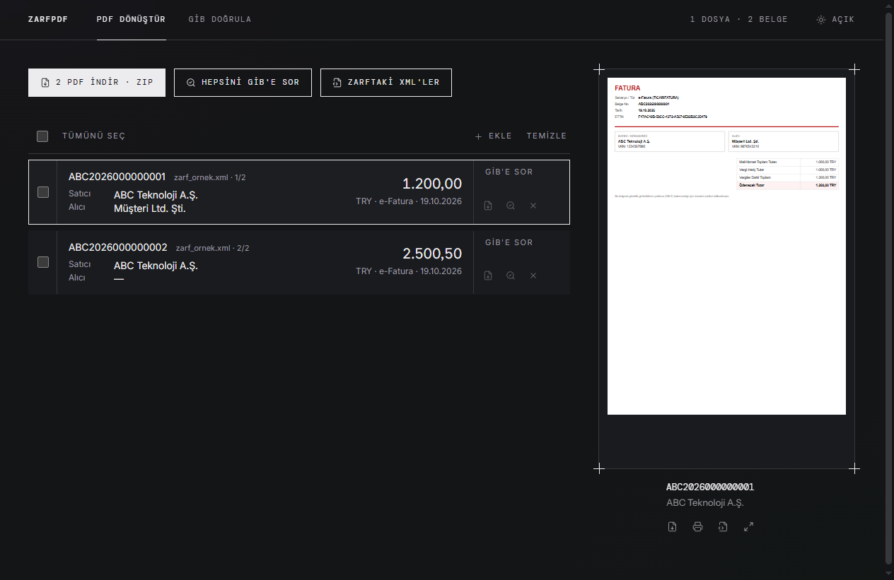

# ZarfPDF

**XML'i bırak, PDF'i al.**

ZarfPDF, GİB zarfı ve UBL-TR XML'lerini (e-Fatura, e-Arşiv, e-İrsaliye) A4 PDF'e çeviren bir Windows masaüstü uygulamasıdır. Belgenin GİB kaydını da uygulamanın içinden sorgular. Dosyalar bilgisayardan çıkmaz. Sunucu, hesap ya da giriş yoktur.



## Ne işe yarar

Entegratörden ya da e-postadan gelen XML'lerin çoğu **zarflıdır** (`StandardBusinessDocument` / `Package`). GİB'in görüntüleyicisi yalnızca doğrudan `Invoice` veya `DespatchAdvice` ile başlayan belgeleri açar, zarflı dosyada hata verir. ZarfPDF zarfı açar, içindeki her belgeyi ayrı ayrı çıkarır ve PDF'e çevirir.

| Verdiğin | Aldığın |
|---|---|
| Tek XML | Tek PDF |
| Zarf XML | İçindeki her belge için bir PDF, istersen temiz XML'leri de |
| ZIP ya da klasör | İçindeki her belge listede, hepsi tek ZIP'te `FATURANO_FIRMA.pdf` adıyla |
| Satıcı VKN + belge no | GİB'in kayıt sonucu: Geçerli, İptal, Reddedildi, Bulunamadı |

## Özellikler

- **Sürükle-bırak:** XML, ZIP ya da klasör. Aynı dosya iki kez eklenmez.
- **Canlı önizleme:** Satıra tıklayınca sağda PDF'e dönüşecek A4 sayfanın kendisi görünür.
- **Orijinal görünüm:** Belgeye gömülü firma XSLT'si varsa o kullanılır. Yoksa standart A4 şablonu devreye girer. XSLT, WebAssembly tabanlı libxslt (`xslt-polyfill`) ile işlenir.
- **Toplu indirme:** Yüzlerce belge sırayla çevrilir ve ilerleme gösterilir. Çevrilemeyen belgeler ZIP içindeki `_RAPOR.txt`'ye yazılır.
- **GİB sorgusu:** Listeden tek tıkla, "Hepsini GİB'e sor" ile ya da ayrı sekmedeki formla yapılır. Sonuç, PDF sayfasının köşesine mühür olarak basılır.
- **Açık ve koyu tema.**

## GİB sorgusu nasıl çalışır

Sorgu, uygulamanın ana sürecinden `sorgu.efatura.gov.tr` adresine **kullanıcının kendi internet bağlantısıyla** gider. Arada başka sunucu yoktur. GİB yurt dışı ve bulut IP'lerini engellediği için sorgu yalnızca **Türkiye IP'sinden** çalışır.

Uygulamanın dışarıya gönderdiği tek istek budur. XML içerikleri hiçbir yere gönderilmez.

## Kurulum

`npm run dist` ile üretilen `release/ZarfPDF Setup <sürüm>.exe` dosyasını çalıştırın.

- Kurulum dosyası imzasızdır. Windows SmartScreen'de **Daha fazla bilgi → Yine de çalıştır** seçeneğini kullanın.
- Otomatik güncelleme yoktur. Yeni sürüm, yeni kurulum dosyasıyla elle kurulur.
- Şimdilik yalnızca Windows için paketleniyor. macOS ve Linux sonra eklenecek.

## Geliştirme

Gereksinim: Node.js 20+

```bash
npm install
npm run dev      # Vite + Electron geliştirme penceresi
npm test         # Vitest
npm start        # Üretim derlemesini Electron'da aç
npm run dist     # Windows kurulum dosyası → release/
```

### Yapı

```
electron/
  main.ts        Ana süreç: pencere, dış linkler, gib:query IPC kanalı
  preload.ts     Arayüze yalnızca window.gib.query açar
  gibProxy.ts    GİB isteği: parametre beyaz listesi, zaman aşımı
src/
  components/    React arayüzü (ConvertView, GibView, PlatePreview, Seal)
  lib/           Zarf çözme, UBL okuma, XSLT, PDF, toplu işlem, GİB istemcisi
scripts/         esbuild ile Electron derlemesi ve geliştirme başlatıcısı
tests/           GİB proxy ve IPC köprüsü testleri
```

### Güvenlik

- Arayüzün Node erişimi yoktur: `contextIsolation`, `sandbox` açık ve `nodeIntegration` kapalıdır.
- XML ayrıştırmada DTD/XXE girdileri reddedilir.
- Uygulama içinde dış sayfa açılmaz. Linkler sistem tarayıcısında açılır.
- GİB yanıtındaki bozuk `Content-Length` başlığı yüzünden yalnızca bu istek `insecureHTTPParser` ile okunur.

### Tasarım

Arayüz kuralları (renkler, tipografi, bileşenler) [`DESIGN.md`](DESIGN.md) dosyasındadır. Ürün bağlamı [`PRODUCT.md`](PRODUCT.md) dosyasındadır.
